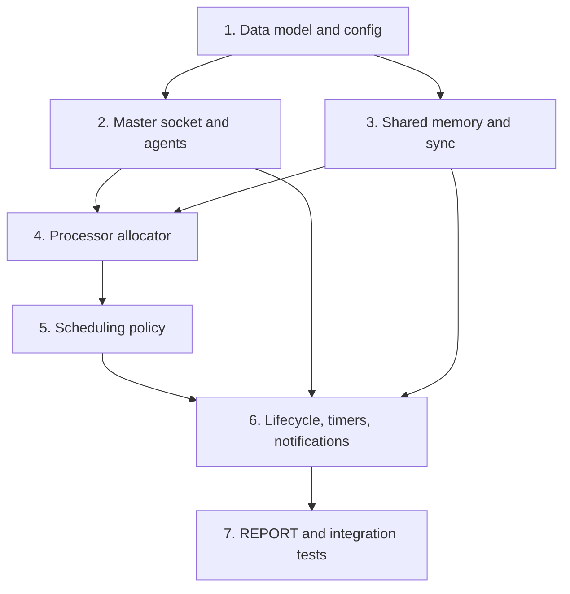

# 01 — Implementation Sequence

> **Goal:** Reduce integration risk by building the HW1 system in dependency order. This is a **proposed workflow**, not an instructor-defined schedule.

## Roadmap

> The arrows show logical dependencies. You can prototype the allocator and scheduler against controlled in-memory test data before wiring them into the multiprocess runtime.

## Step-by-step gates

| Step | Area | Build / decide | Gate before continuing |
| --- | --- | --- | --- |
| 1 | Configuration and state model | `M`, `N`, capacities, jobs, connection slots, invariants | Valid configuration loads; invalid input rejected predictably |
| 2 | Master and agent networking | Both socket address formats; accept/fork; per-connection PID; disconnect/reap | Multiple `nc` connections work; parent remains listening |
| 3 | Shared state and coordination | Anonymous shared mapping (or `shmget`); capacity slots; process-shared primitives | Two distinct agent processes see the same state and preserve consistency |
| 4 | Allocation | Per-type single-node fit; node choices; reserve and release | Capacity never negative; reservation followed by release restores originals |
| 5 | Scheduler | Feasible set, `MAX`, wait/budget comparison, dominance, tie rule | Deterministic hand-calculated small examples match decisions |
| 6 | Lifecycle | Two agent threads; submit/start/timeout/stop/quit; asynchronous notifications | No double release or missing wakeups under races |
| 7 | Reporting and hardening | Sorted consistent `REPORT`; concurrency, protocol and cleanup tests | Correct report and behavior under several simultaneous clients |

## Suggested checkpoints

### Checkpoint A — transport works

A socket client can connect, receive the agent PID and disconnect. Both Unix-domain and IPv4 addressing are supported. No scheduling is required yet.

### Checkpoint B — state is genuinely shared

Two agents can safely observe a shared connection/job table; slots are not duplicated. Confirm child processes inherit the mapping created before `fork()`.

### Checkpoint C — allocator works independently

A synthetic job either receives a legal node-per-type assignment or stays unallocated. Release restores the exact previously deducted resources.

### Checkpoint D — selection is explainable

Given several waiting jobs, you can explain which are feasible, which dominate which others, and which tie rule decides the winner. Confirm the ambiguous parts of the policy with the course forum where needed.

### Checkpoint E — complete job journey

`SUBMIT` leads to `OK`, potential waiting, eventual start notification, then completion-time termination notification; `STOP` and `QUIT` do proper cleanup.

### Checkpoint F — instructor-format parity

The required `REPORT` ordering, units, connection IDs and notification strings match the PDF, and `make hw1` satisfies the submission contract.

## Cross-cutting checks at every step

- **State ownership:** Which process/thread executes the operation, and which shared structures change?
- **Locking:** Must the operation be atomic? Can it block? What wakes observers?
- **Timeout:** Are all time quantities in milliseconds and measured consistently?
- **Cleanup:** What happens if an error, disconnect, STOP or QUIT interrupts the operation?
- **Testing:** Is there a minimal repro that isolates this module from unrelated parts?

## Unresolved specification items to track

- **[OPEN]** `MAX` is named in the scheduler rules but the PDF does not provide a numeric value (pp. 1–2).
- **[OPEN]** The wording of the dominance/tie rule includes the literal **minimum of `wait − budget`**; don't replace it with a more intuitive formula without clarification (p. 2).
- **[OPEN]** Error replies for invalid commands, second SUBMIT, and some STOP cases are not fully specified; preserve required behavior and document any chosen responses.
- **[PROPOSED]** A shared scheduler function called by agents is a simple design; the assignment requires a multiprocess master/agent architecture but does not mandate a dedicated scheduler process.

**Source:** `ceng536-hw1.pdf`, §§1–6; module order and checkpoints are recommendations.
